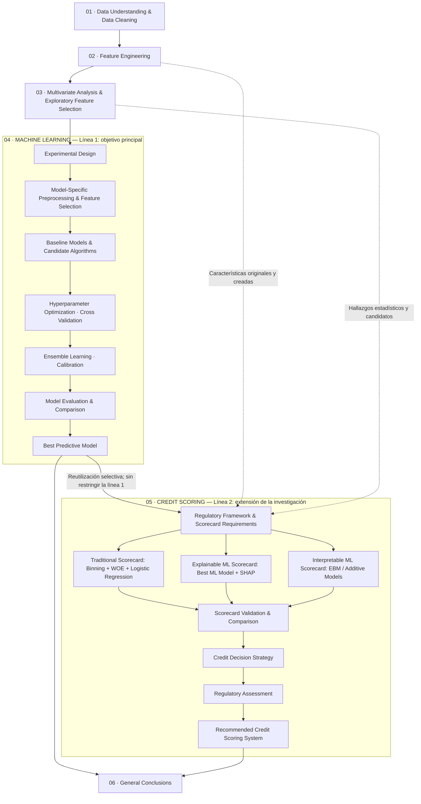

# Home Credit Default Risk — Project Roadmap

**Documento maestro de metodología, checklist y continuidad del proyecto**  
Proyecto: `home-credit-risk-ml` · Versión 1.0 · 24 de noviembre de 2026

> Este documento recoge la estructura acordada para el proyecto. Es una guía de trabajo, no un reporte de resultados. Las casillas indican tareas por comprobar o ejecutar; no implican que todo esté pendiente en el repositorio. Actualizar su estado únicamente después de revisar los notebooks y sus resultados. La numeración identifica etapas metodológicas, no necesariamente archivos individuales.

## 0. Propósito y acuerdos del proyecto

### Objetivo principal — Machine Learning

Desarrollar, comparar y optimizar modelos de Machine Learning para predecir el riesgo crediticio en Home Credit Default Risk, evaluando el impacto de la ingeniería de características, el análisis estadístico multivariado, la selección de variables y la optimización de hiperparámetros sobre el desempeño fuera de muestra.

**Pregunta principal:** ¿Qué combinación de características, preprocesamiento, selección de variables y modelos permite obtener el mejor desempeño predictivo del riesgo crediticio?

### Objetivo complementario — Credit Scoring

Construir y comparar sistemas de puntuación crediticia tradicionales, explicables e intrínsecamente interpretables, reutilizando selectivamente los datos, características, modelos y hallazgos de Machine Learning, y evaluando su alineación con el marco regulatorio financiero mexicano.

**Pregunta complementaria:** ¿Cómo trasladar la capacidad predictiva de los Machine Learning models a un sistema de puntuación crediticia interpretable, estable y auditable, sin perder innecesariamente desempeño?

### Principios metodológicos no negociables

- **Secuencia:** primero desarrollar la línea de Machine Learning; después desarrollar la línea de Credit Scoring. No son dos ramas paralelas desde el principio.
- **Libertad experimental:** no condicionar la primera línea a que sus características, transformaciones o algoritmos sean convenientes para una Scorecard. Binning, WOE, PCA, interacciones y selección de variables son alternativas que se deben evaluar, no requisitos universales.
- **Reutilización selectiva:** la segunda línea puede recuperar elementos de cualquiera de las primeras cuatro etapas, no únicamente del modelo ganador. Puede volver a las características originales, realizar sus propias transformaciones y reajustar modelos cuando esté justificado.
- **Comparaciones independientes:** Model Evaluation & Comparison pertenece a Machine Learning; Scorecard Validation & Comparison pertenece a Credit Scoring. Puede haber dos recomendaciones diferentes.
- **Fundamento:** cada procedimiento debe responder a una pregunta, tener una justificación estadística o financiera y aportar evidencia. No aplicar técnicas únicamente por incluirlas en el proyecto.
- **Regulación:** el marco regulatorio se estudia al inicio de Credit Scoring y su alineación se evalúa al final de esa línea. Los requisitos legales y éticos transversales pertinentes (por ejemplo, privacidad, no discriminación y disponibilidad de datos) no se posponen.
- **Evaluación honesta:** no seleccionar variables, modelos, transformaciones, umbrales o scorecards con el conjunto de prueba final. No inventar resultados ni presentar cumplimiento regulatorio como certificado.

## 0.1. Flujo de trabajo general

**Lectura del flujo:** las etapas 01–03 construyen la base común; la etapa 04 selecciona el mejor modelo predictivo usando únicamente información de desarrollo; la etapa 05 desarrolla tres enfoques de puntuación con criterios propios; la etapa 06 integra los hallazgos. Las flechas punteadas representan elementos que se pueden recuperar, no obligaciones de reutilización.

Si el visor de Markdown no soporta Mermaid, la secuencia equivalente es: `01 → 02 → 03 → 04 (ML y comparación de modelos) → 05 (Credit Scoring y comparación de scorecards) → 06 (conclusiones)`.

## 0.2. Protocolo transversal de diseño experimental

Definir las particiones **antes de cualquier transformación supervisada o decisión basada en datos que pueda influir en el modelo**, aunque el apartado formal de Experimental Design aparezca en la etapa 04.

- [ ] Definir unidad de análisis (solicitante/crédito), variable respuesta `TARGET`, instante de predicción y población de estudio.
- [ ] Distinguir datos etiquetados de desarrollo del archivo de test de Kaggle, que no contiene `TARGET`.
- [ ] Crear y persistir un holdout final etiquetado, independiente y común a las dos líneas. Usar estratificación cuando corresponda; si existen clientes repetidos, evitar que un mismo cliente aparezca en varias particiones.
- [ ] Definir folds comunes de desarrollo, semilla, métricas primarias, presupuesto de búsqueda y protocolo de comparación. Guardar identificadores de partición.
- [ ] Ajustar imputación, escalamiento, codificación, binning, WOE, IV, PCA, selección y cualquier transformación aprendida exclusivamente sobre los datos de entrenamiento de cada fold. Aplicar los objetos ajustados a la validación sin recalcularlos con sus etiquetas.
- [ ] Utilizar validación cruzada para selección y tuning; considerar validación anidada u otra partición interna independiente si se necesita una estimación menos optimista tras búsquedas extensas.
- [ ] Para calibración, stacking, distillation o selección de umbrales, utilizar predicciones out-of-fold o subconjuntos de desarrollo independientes según el método.
- [ ] Mantener cerrado el holdout mientras se diseñan ambas líneas. El ganador de ML que se reutiliza en Credit Scoring se elige por validación de desarrollo, no por el holdout. Evaluar en holdout los candidatos finales previamente fijados cuando ambas líneas estén listas; no reajustar a partir de esos resultados.
- [ ] Auditar fuga temporal: solo emplear información disponible al momento de la solicitud; comprobar ventanas de agregación de las tablas históricas.
- [ ] No afirmar estabilidad temporal u OOT si no existen fechas o cohortes cronológicas fiables. Las particiones aleatorias permiten evaluar estabilidad muestral, no necesariamente temporal.
- [ ] Registrar semillas, versiones de librerías, parámetros, variables, particiones, métricas y decisiones para reproducibilidad.

---

# 01. Data Understanding & Data Cleaning

**Objetivo:** comprender qué representa cada tabla y variable, identificar problemas de calidad y construir datos consistentes, sin tomar todavía decisiones de modelamiento irreversibles.

## 1.1. Data Understanding

- [ ] Inventariar tablas disponibles de Home Credit y consultar sus descripciones originales.
- [ ] Identificar granularidad, llaves, cardinalidades, relaciones y posibles duplicados (por ejemplo, `SK_ID_CURR`, `SK_ID_PREV`, `SK_ID_BUREAU`, según tabla).
- [ ] Comprender la definición de `TARGET`, su horizonte conocido y sus limitaciones; no equipararlo automáticamente a un default regulatorio mexicano a doce meses.
- [ ] Identificar el significado financiero y unidades de las variables, valores especiales y momento de disponibilidad.
- [ ] Establecer qué tablas y columnas se utilizarán, cuáles requieren revisión y cuáles no estarán disponibles al momento de predicción.

## 1.2. Exploratory Data Analysis (EDA)

- [ ] Revisar dimensiones, tipos de datos, distribuciones, cuantiles, cardinalidad y desbalance de `TARGET` en desarrollo.
- [ ] Visualizar distribuciones y relaciones preliminares de las variables con el incumplimiento.
- [ ] Analizar patrones de faltantes, valores extremos y categorías poco frecuentes.
- [ ] Formular hipótesis explicativas, distinguiendo asociación estadística de causalidad.

## 1.3. Data Quality

- [ ] Comprobar integridad referencial, unicidad de claves, registros repetidos y consistencia entre tablas.
- [ ] Detectar valores imposibles, códigos especiales de ausencia, inconsistencias de signos/fechas y unidades incompatibles.
- [ ] Distinguir faltantes estructurales, ausencia de historial y datos efectivamente desconocidos.
- [ ] Revisar variables susceptibles de fuga, información posterior al otorgamiento y variables sensibles o posibles proxies.
- [ ] Generar bitácora de problemas: variable, hallazgo, evidencia, impacto y tratamiento propuesto.

## 1.4. Data Cleaning

- [ ] Aplicar correcciones justificadas y documentarlas; preservar datos originales o snapshots reproducibles.
- [ ] Homogeneizar tipos, formatos y códigos de ausencia.
- [ ] Resolver duplicados y anomalías de acuerdo con la granularidad real de cada tabla.
- [ ] No imputar o eliminar atípicos válidos de forma indiscriminada; dejar tratamientos dependientes del algoritmo para los pipelines correspondientes.
- [ ] Validar conteos antes/después, integridad de llaves y ausencia de pérdidas no justificadas.
- [ ] Guardar las tablas limpias y el diccionario de datos actualizado.

**Entregable / criterio de cierre:** tablas limpias reutilizables, diagnóstico de calidad, diccionario, reglas de limpieza y limitaciones documentadas.

---

# 02. Feature Engineering

**Objetivo:** transformar la información de solicitudes, créditos previos, buró e historial de pagos en características útiles para explicar y predecir el riesgo; mantener las características originales elegibles para que cada modelo pueda decidir cómo utilizarlas.

## 2.1. Financial Ratios

- [ ] Construir candidatos de capacidad de pago, carga financiera, solvencia y endeudamiento.
- [ ] Considerar ratios crédito/ingreso, anualidad/ingreso, deuda vigente/ingreso y pagos realizados/pagos comprometidos, cuando las unidades y fuentes lo permitan.
- [ ] Manejar denominadores cero, valores faltantes y unidades temporales de forma explícita; no asumir que un nombre de columna garantiza su periodicidad.
- [ ] Analizar la justificación financiera y comportamiento empírico de cada ratio.

## 2.2. Historical Aggregations

- [ ] Definir agregaciones por solicitante a partir de tablas elegibles: buró, créditos previos, cuotas, saldos y comportamiento histórico.
- [ ] Evaluar frecuencia, severidad y recencia de atrasos; exposición, utilización, saldo y comportamiento de pagos.
- [ ] Experimentar con conteos, proporciones, medias, máximos, dispersión, tendencias y ventanas históricas coherentes con el instante de solicitud.
- [ ] Diferenciar ausencia de historial de un historial con cero eventos; verificar el significado económico de los valores nulos.
- [ ] Comprobar cardinalidad de joins y evitar multiplicar filas o incluir información futura.

## 2.3. Feature Construction

- [ ] Construir una base de características a nivel de unidad de predicción, con llaves y `TARGET` separados de los predictores.
- [ ] Evaluar transformaciones candidatas: logaritmos, ratios, indicadores de ausencia, interacciones y otras representaciones justificadas.
- [ ] Conservar una versión base sin binning/WOE obligatorio. WOE se podrá experimentar como representación alternativa durante ML y desarrollar específicamente durante Credit Scoring.
- [ ] Revisar distribuciones, consistencia y redundancia de características creadas.
- [ ] Registrar cualquier transformación que deba ajustarse por fold en lugar de materializarse globalmente.

## 2.4. Feature Documentation

- [ ] Elaborar catálogo de características: nombre, descripción, tabla/columnas de origen, fórmula, granularidad, unidad, ventana temporal, tratamiento de nulos y justificación financiera.
- [ ] Registrar hipótesis de relación con riesgo (creciente, decreciente, no lineal o desconocida), sin imponerlas sin evidencia.
- [ ] Señalar posibles riesgos de sesgo, fuga o dificultad de interpretación.
- [ ] Versionar la matriz de características y las funciones de construcción.

**Entregable / criterio de cierre:** feature dataset reproducible, catálogo de características y funciones de construcción listas para los pipelines. Las transformaciones dependientes del modelo permanecen opcionales.

---

# 03. Multivariate Analysis & Feature Selection

**Objetivo:** comprender la estructura estadística de las características e identificar candidatos, redundancias y patrones útiles. Esta etapa es exploratoria; no debe imponer un conjunto único de variables a todos los modelos.

## 3.1. Correlation & Redundancy

- [ ] Analizar correlaciones apropiadas al tipo de dato (Pearson, Spearman u otras medidas pertinentes).
- [ ] Identificar grupos de variables redundantes y revisar su interpretación financiera, disponibilidad y calidad.
- [ ] Distinguir correlación entre predictores de asociación con `TARGET`.
- [ ] Evaluar constantes, casi constantes, duplicados y posibles proxies; justificar cualquier exclusión universal.

## 3.2. Principal Component Analysis (PCA)

- [ ] Seleccionar el subconjunto numérico pertinente y definir tratamiento de faltantes/escalamiento.
- [ ] Analizar varianza explicada, cargas, relaciones entre componentes y estructura multivariada.
- [ ] Interpretar componentes y considerar su uso como características adicionales o reducción dimensional solo si aporta valor.
- [ ] Comparar desempeño con y sin PCA cuando sea pertinente; ajustar PCA dentro del pipeline de entrenamiento.
- [ ] No obligar a una Scorecard a utilizar componentes si dificultan la interpretación financiera.

## 3.3. Cluster Analysis

- [ ] Definir qué perfiles o estructura de clientes queremos investigar y qué variables son pertinentes.
- [ ] Evaluar métodos, distancias y número de grupos con criterios de separación, estabilidad e interpretación.
- [ ] Analizar perfiles y tasas de incumplimiento en desarrollo, evitando usar `TARGET` para construir grupos no supervisados.
- [ ] Si los grupos se usan como predictores, definir asignación a nuevos clientes y validar su utilidad fuera de muestra; evitar seleccionar con el holdout.
- [ ] No conservar clustering como feature si no aporta evidencia de utilidad.

## 3.4. Information Value (IV) & Weight of Evidence (WOE)

- [ ] Definir una convención de WOE (malo/bueno) y calcular distribuciones, tasas de default, WOE e IV.
- [ ] Comparar binning por frecuencia, cortes financieros y árboles u optimización supervisada, cuando proceda.
- [ ] Evaluar tamaño de bins, representatividad de ambas clases, faltantes, suavizado, monotonicidad razonable y estabilidad de cortes.
- [ ] Utilizar IV como evidencia discriminante univariada; no convertir sus umbrales empíricos en leyes ni descartar automáticamente variables con IV bajo.
- [ ] Investigar IV inusualmente alto como posible señal de fuga, sin asumir que necesariamente lo es.
- [ ] Estimar todos los cortes y WOE exclusivamente con train de cada fold si se incorporan al modelamiento.

Con la convención utilizada en clase, para el bin i:

$$
 d_{b,i}=\frac{n_{b,i}}{N_b},\quad d_{g,i}=\frac{n_{g,i}}{N_g},\quad WOE_i=\ln\left(\frac{d_{b,i}}{d_{g,i}}\right),\quad IV=\sum_i(d_{b,i}-d_{g,i})WOE_i.
$$

La tasa de default del bin es $n_{b,i}/(n_{b,i}+n_{g,i})$; no confundirla con $d_{b,i}$.

## 3.5. Exploratory Feature Selection

- [ ] Consolidar hallazgos de calidad, correlación, PCA, clustering, IV y sentido financiero.
- [ ] Identificar variables elegibles, candidatas a reducción, candidatas a transformación y variables que deban excluirse por fuga o invalidez.
- [ ] Preparar escenarios de características, sin eliminar de forma agresiva variables solo por baja asociación individual o alta correlación.
- [ ] Mantener disponibles las características originales elegibles para los modelos que aprovechen relaciones no lineales o interacciones.

**Entregable / criterio de cierre:** análisis multivariado documentado, hipótesis y conjuntos candidatos; no una selección definitiva común a todos los modelos.

---

# 04. Machine Learning — Línea de investigación principal

**Objetivo:** encontrar el mejor modelo predictivo bajo un diseño experimental reproducible. Cada algoritmo puede utilizar una representación y un conjunto de características propios. La línea no queda condicionada por el desarrollo posterior de Scorecards.

## 4.1. Experimental Design

- [ ] Confirmar el protocolo transversal de la sección 0.2 antes de comenzar los experimentos.
- [ ] Definir ROC-AUC como métrica principal inicial (coherente con la competencia), junto con PR-AUC, KS, Gini y métricas de calibración como complementarias; fijar el criterio de selección antes de consultar los resultados finales.
- [ ] Establecer un baseline sencillo y las condiciones de comparación: folds comunes, semillas, presupuesto de búsqueda, recursos y estrategia para tratar el desbalance.
- [ ] Definir cómo evaluar la ganancia de Feature Engineering, PCA, WOE, clustering y selección mediante comparaciones controladas o ablaciones.
- [ ] Registrar las hipótesis, configuraciones de experimentos y reglas para decidir cuándo una mejora es relevante.

## 4.2. Model-Specific Preprocessing

- [ ] Diseñar pipelines según los supuestos y capacidades de cada familia de modelos.
- [ ] Evaluar imputación, escalamiento, codificación categórica, transformaciones, faltantes nativos y manejo de atípicos cuando corresponda.
- [ ] Considerar variables originales, características creadas y representaciones alternativas (WOE, componentes principales, indicadores de pertenencia a grupos, interacciones), sin asumir una transformación universal.
- [ ] Evaluar WOE como experimento: variables originales/creadas frente a WOE frente a una combinación selectiva, si existe una hipótesis clara. Los árboles pueden aprender cortes propios; WOE podría regularizar relaciones o perder información.
- [ ] Comparar tratamientos del desbalance cuando sea pertinente; no aplicar SMOTE o ponderaciones automáticamente. Comprobar el efecto sobre la calibración de probabilidades.
- [ ] Ajustar cada transformación dentro de los folds y guardar su pipeline completo.

## 4.3. Model-Specific Feature Selection

Una característica puede aportar poco a una logística lineal sin transformaciones, pero mucho a un modelo de árboles que captura relaciones no lineales e interacciones. Por eso no existe obligación de utilizar las mismas variables en todos los modelos.

| Familia | Métodos candidatos (no obligatorios) |
|---|---|
| Logistic Regression | LASSO, Elastic Net, VIF como diagnóstico, Stepwise/AIC como comparación, transformaciones no lineales |
| Random Forest | Permutation Importance, RFE, Boruta |
| AdaBoost / Gradient Boosting | Importancia, permutación, selección iterativa |
| XGBoost / LightGBM | Gain Importance, SHAP, permutación y selección iterativa |
| CatBoost | Feature Importance, SHAP, selección recursiva |
| EBM | Importancia de términos y análisis de las funciones aprendidas |

- [ ] Comparar, según recursos, tres escenarios: A) todas las características elegibles; B) subconjunto propuesto por el análisis exploratorio; C) selección específica para el modelo.
- [ ] Evaluar la selección en validación, no solo por importancias dentro de train; las importancias pueden ser sensibles a correlación y cardinalidad.
- [ ] Incorporar selección, preprocesamiento y tuning como partes del mismo diseño experimental cuando corresponda.
- [ ] Registrar variables seleccionadas, estabilidad entre folds, pérdida/ganancia de desempeño y reducción de complejidad.
- [ ] No forzar un método de selección distinto en cada modelo si no proporciona una ventaja comprobable.

## 4.4. Baseline Models

- [ ] Implementar un baseline simple (por ejemplo, regresión logística) y comparar con una referencia trivial de prevalencia cuando sea útil para contextualizar las métricas.
- [ ] Entrenar candidatos de Machine Learning: Logistic Regression, Random Forest, AdaBoost, Gradient Boosting, XGBoost, LightGBM, CatBoost y EBM; ampliar o reducir el listado según evidencia y presupuesto.
- [ ] Registrar desempeño, tiempo de entrenamiento, tiempo de inferencia, número de características y configuración inicial.
- [ ] Comparar resultados de validación antes del tuning para priorizar modelos; no declarar ganador por una sola partición favorable.

## 4.5. Hyperparameter Optimization

- [ ] Definir hiperparámetros y rangos de búsqueda con fundamento en cada algoritmo: regularización, profundidad, learning rate, número de árboles, muestreo y otros pertinentes.
- [ ] Seleccionar una estrategia de búsqueda (grid, random, bayesiana/Optuna u otra) y presupuestos comparables o explícitamente justificados.
- [ ] Utilizar validación cruzada y early stopping correctamente, sin utilizar el holdout para ninguna decisión.
- [ ] Analizar curvas de aprendizaje, variabilidad entre folds, sobreajuste y costo computacional.
- [ ] Guardar hiperparámetros, resultados de trials, semillas y justificación de la configuración final.

## 4.6. Ensemble Learning

- [ ] Investigar si voting, blending, stacking u otros ensembles mejoran a los mejores modelos individuales.
- [ ] Analizar diversidad y complementariedad de errores entre modelos.
- [ ] Utilizar predicciones out-of-fold para entrenar metamodelos y evitar fuga de información.
- [ ] Comparar el ensemble con los modelos individuales bajo el mismo protocolo; mantenerlo únicamente si la mejora lo justifica.

## 4.7. Model Calibration

- [ ] Analizar si las probabilidades estimadas se corresponden con las frecuencias observadas de `TARGET`.
- [ ] Evaluar curvas de calibración, Brier Score, Log Loss y PD promedio frente a tasa observada; considerar intercepto y pendiente de calibración.
- [ ] Comparar, si es necesario, calibración sigmoidal/Platt, isotónica u otras alternativas apropiadas, usando datos internos independientes o predicciones out-of-fold.
- [ ] Guardar el calibrador junto con el pipeline y distinguir la salida original del modelo de la probabilidad calibrada.
- [ ] No asumir que un modelo con mayor AUC tiene mejores probabilidades.

## 4.8. Model Evaluation & Comparison

Esta comparación pertenece exclusivamente a la línea de Machine Learning. No elegir aquí el mejor sistema de puntuación ni penalizar un modelo solo por ser difícil de convertir en una Scorecard.

- [ ] Comparar ROC-AUC, PR-AUC, KS, Gini, Brier Score, Log Loss y desempeño por folds.
- [ ] Evaluar sensibilidad, especificidad, precision, recall, F1 y balanced accuracy cuando exista un umbral fijado en desarrollo.
- [ ] Analizar brechas train/validación, estabilidad muestral, incertidumbre de las métricas y sensibilidad a las representaciones de características.
- [ ] Comparar mejoras de Feature Engineering, selección, tuning, calibración y ensembles frente a sus respectivas referencias.
- [ ] Evaluar complejidad y costo computacional como criterios complementarios; no forzar interpretabilidad intrínseca como filtro para ganar esta línea.
- [ ] Definir una clasificación de modelos con métricas de desarrollo, usando diferencias prácticamente relevantes y no solo decimales de AUC.

## 4.9. Best Predictive Model

- [ ] Seleccionar el mejor candidato predictivo mediante la evidencia de desarrollo, sin predeterminar que será XGBoost.
- [ ] Reajustar pipeline y calibración bajo el protocolo fijado; congelar configuración, variables, transformaciones y versión del modelo.
- [ ] Guardar modelo, pipeline, predicciones de desarrollo, calibrador, métricas, identificadores de folds y documentación reproducible.
- [ ] Preservar también el mejor modelo interpretable, la logística de referencia y otros candidatos relevantes para Credit Scoring.
- [ ] Explicar la selección mediante XYZ: X = hallazgo sustentado en resultados; Y = explicación o hipótesis razonada; Z = implicación para el proyecto.
- [ ] Reportar el desempeño final de los candidatos congelados en el holdout común al cierre de ambas líneas, sin volver a ajustar a partir de él.

**Entregable / criterio de cierre:** ganador predictivo seleccionado en desarrollo, experimentos comparables, modelos y pipelines reutilizables, evidencias y limitaciones. No se requiere que el ganador sea interpretable por construcción.

---

# 05. Credit Scoring — Segunda línea de investigación

**Objetivo:** investigar cómo convertir los resultados de la primera línea en un sistema de puntuación crediticia, construir tres enfoques y evaluar su capacidad predictiva, calibración, estabilidad, interpretabilidad, parsimonia, utilidad financiera y alineación regulatoria.

La finalidad es una **Application Scorecard**: evaluar a un solicitante antes de otorgarle un crédito. Se distingue de una Behavioral Scorecard (seguimiento durante la vida del crédito) y una Collection Scorecard (cobranza).

### Puente entre Machine Learning y Credit Scoring

| Elemento de etapas previas | Acción en Credit Scoring |
|---|---|
| Datos limpios | Reutilizar como base común. |
| Características originales y creadas | Reutilizar las elegibles; seleccionar nuevamente si es necesario. |
| Análisis multivariado, WOE/IV exploratorio | Recuperar hallazgos, no necesariamente los objetos ajustados o cortes. |
| Folds y holdout | Mantener el diseño común. No abrir el holdout para rediseñar la línea. |
| Mejor modelo predictivo | Recuperar su pipeline completo para explicar sus predicciones, si es viable. |
| Logística de la línea ML | Recuperar como referencia; reajustar con WOE si la Scorecard tradicional lo requiere. |
| EBM/modelos aditivos | Recuperar o reajustar a una estructura compatible con la Scorecard. |
| Feature selection, PCA, interacciones | Reevaluar según interpretabilidad, parsimonia, evidencia y finalidad. |
| Binning y WOE | Desarrollar específicamente para la Scorecard tradicional; no exigirlos al modelo complejo. |

**Regla:** no reutilizar por obligación. Cada modelo de puntuación puede requerir un preprocesamiento, conjunto de características o modelo diferente. Si el ganador predictivo no se puede explicar satisfactoriamente, documentar la limitación y evaluar candidatos alternativos sin alterar retrospectivamente el resultado de la línea ML.

## 5.1. Regulatory Framework & Scorecard Requirements

Estudiar la normativa antes de decidir cómo construir y comparar las Scorecards. La revisión anterior fue preliminar; esta sección establece tareas, no certifica cumplimiento.

- [ ] Definir el tipo de entidad y uso que se desea simular: originación de crédito de consumo en una institución de crédito mexicana como referencia inicial; verificar aplicabilidad.
- [ ] Consultar fuentes oficiales vigentes (CNBV, DOF, legislación aplicable) y registrar fecha de consulta, versión, artículo, fracción y enlace.
- [ ] Revisar el artículo 15 de la Circular Única de Bancos (CUB), particularmente las disposiciones pertinentes a métodos de evaluación y otorgamiento paramétrico de créditos de consumo.
- [ ] Distinguir originación de modelos internos prudenciales; revisar el Anexo 15 de la CUB como referencia de validación y documentación donde sea pertinente, sin trasladar automáticamente sus obligaciones a otro uso.
- [ ] Verificar si existen restricciones específicas sobre algoritmos, explicabilidad, datos utilizados, documentación, autorización, validación y monitoreo para el supuesto elegido. No asumir que solo está permitida la regresión logística ni que SHAP equivale a aprobación regulatoria.
- [ ] Revisar obligaciones pertinentes de protección de datos personales, no discriminación y uso de información crediticia.
- [ ] Formular criterios de Scorecard: trazabilidad, consistencia, reproducibilidad, calidad predictiva, calibración, estabilidad, justificación financiera y explicaciones comprensibles, distinguiendo obligaciones de buenas prácticas.
- [ ] Crear matriz de trazabilidad: disposición, cita exacta, requisito, aplicabilidad, evidencia requerida, procedimiento del proyecto y limitación.
- [ ] Reconocer límites de Home Credit: la población no demuestra representatividad mexicana, la definición de `TARGET` no especifica todos los parámetros de default y no se acredita validación temporal o autorización institucional.

## 5.2. Traditional Scorecard — Logística + WOE

**Objetivo:** construir una referencia tradicional, transparente y auditable, con puntos fijos por intervalo de cada variable.

- [ ] Seleccionar características con sentido financiero, disponibilidad al otorgamiento y evidencia de utilidad.
- [ ] Comparar binning (fine classing y coarse classing), WOE, IV, tamaño de intervalos y monotonicidad cuando se justifique.
- [ ] Tratar faltantes y casos con cero buenos/malos de manera consistente; comparar escenarios si la exclusión por faltantes es dudosa.
- [ ] Seleccionar variables y ajustar logística con WOE; revisar signos, multicolinealidad, estabilidad, parsimonia, calibración y aportación incremental.
- [ ] Definir escala común de puntuación: puntos base de referencia, odds bueno/malo de referencia y PDO. Los valores de clase (600, 20:1, 50) son un ejemplo, no una obligación regulatoria.
- [ ] Construir y verificar la tabla de puntos por intervalo y la equivalencia con la predicción del modelo (salvo redondeo explícito).
- [ ] Aplicar la Scorecard a clientes, documentar casos ilustrativos y generar explicaciones individuales.

Con $p(x)$ como probabilidad de `TARGET = 1`, $Z(x)=\log[p(x)/(1-p(x))]$, $F=PDO/\ln(2)$ y $A=S_0-F\ln(O_0)$, donde $O_0$ son odds **bueno/malo** de referencia:

$$
S(x)=A-FZ(x)=A-F\beta_0- F\sum_j\beta_j WOE_j(x_j).
$$

La contribución de cada variable es $-F\beta_j WOE_j(x_j)$. Si se aplica una calibración posterior, comprobar si mantiene la descomposición aditiva; documentar cualquier cambio o aproximación.

## 5.3. Explainable ML Scorecard — Mejor modelo predictivo + SHAP

**Objetivo:** aprovechar la capacidad predictiva del ganador de ML y obtener contribuciones individuales explicables, sin imponer binning previo si no lo necesita el modelo.

- [ ] Recuperar el pipeline congelado del ganador, su calibrador y las características utilizadas.
- [ ] Elegir una técnica de explicación compatible (por ejemplo, TreeSHAP para boosting de árboles) y documentar escala de salida, referencia/background y tratamiento de dependencias entre predictores.
- [ ] Analizar explicaciones globales y locales; verificar estabilidad de contribuciones, interacciones, variables correlacionadas y coherencia financiera.
- [ ] Construir un score a partir de probabilidades y, si el modelo admite una descomposición aditiva del logit, convertir las contribuciones a puntos individuales.
- [ ] Verificar numéricamente que puntos base + contribuciones reproduzcan el score original en la escala explicada.
- [ ] Si la calibración es no lineal o SHAP explica otra escala, no asumir que la misma descomposición reproduce el score calibrado; elegir una explicación compatible o medir y documentar el error de aproximación.
- [ ] Generar ejemplos de clientes, principales factores que aumentan/disminuyen el riesgo y criterios de comunicación; SHAP explica el comportamiento del modelo, no demuestra causalidad o justicia de la decisión.
- [ ] Si se investiga una tabla estática de puntos por bins, tratarla como un modelo aproximado separado y medir fidelidad, discrepancias y pérdida predictiva.

Si SHAP descompone exactamente el logit utilizado en el score:

$$
Z(x)=\phi_0+\sum_j\phi_j(x),\qquad S(x)=A-F\phi_0-F\sum_j\phi_j(x).
$$

A diferencia de la tarjeta tradicional, los puntos por característica pueden depender de las demás características del cliente. Por ello, una explicación individual aditiva no convierte al modelo subyacente en una caja blanca ni garantiza puntos universales por intervalo.

## 5.4. Interpretable ML Scorecard — EBM y modelos aditivos

**Objetivo:** aprender relaciones no lineales mediante un modelo interpretable por construcción y comparar si conserva capacidad predictiva suficiente frente a los modelos complejos.

- [ ] Recuperar o entrenar Explainable Boosting Machine (EBM) con estructura aditiva sin interacciones como referencia inicial.
- [ ] Evaluar selección de términos, binning interno, funciones aprendidas, regularización, estabilidad y parsimonia.
- [ ] Analizar efectos de cada característica y, si procede, imponer restricciones de monotonicidad justificadas; comparar contra el modelo sin restricciones.
- [ ] Transformar las contribuciones al logit en puntos fijos por término/intervalo y verificar la suma.
- [ ] Experimentar con un número limitado de interacciones solo si se justifica la mejora; documentar que sus puntos dependen de combinaciones de variables.
- [ ] Considerar Add-XGBoost o distillation (modelo estudiante aditivo que aproxima al ganador) como extensiones opcionales, no compromisos obligatorios. Si se aplican, medir fidelidad además de capacidad predictiva real.

Para un EBM puramente aditivo:

$$
Z(x)=\beta_0+\sum_j f_j(x_j),\qquad S(x)=A-F\beta_0-F\sum_j f_j(x_j).
$$

Las funciones $f_j$ permiten relaciones no lineales sin depender de explicaciones post hoc. En un modelo aditivo por bins, sus contribuciones pueden representarse como una tabla de puntos.

## 5.5. Scorecard Validation & Comparison

Esta comparación pertenece a Credit Scoring. El objetivo no es necesariamente seleccionar el mayor AUC, sino justificar qué sistema de puntuación es más adecuado para la finalidad crediticia.

- [ ] Fijar escala de score común y convenciones de riesgo; comparar probabilidades y scores en la misma población y particiones.
- [ ] Evaluar discriminación: ROC-AUC, PR-AUC, KS, Gini y separación por niveles de riesgo.
- [ ] Evaluar calibración: Brier Score, Log Loss, curvas y diferencias entre PD estimada y tasa observada por grupo.
- [ ] Evaluar estabilidad de scores y variables con PSI y análisis de bins, coeficientes o funciones. Usar referencias y límites justificados; no confundir PSI muestral con estabilidad temporal.
- [ ] Comprobar equivalencia PD-score y fidelidad de explicaciones; analizar efectos del redondeo o aproximaciones.
- [ ] Comparar número de variables/términos, número de bins, interacciones, costo, facilidad de auditoría, consistencia y reproducibilidad.
- [ ] Evaluar coherencia financiera, posibles sesgos y proxies; comparar desempeño/calibración/tasas de decisión por grupos cuando los datos y el marco aplicable lo permitan.
- [ ] Analizar la diferencia predictiva frente al ganador de ML y determinar si la pérdida o mejora justifica la diferencia en complejidad e interpretabilidad.
- [ ] Seleccionar candidatos de puntuación en desarrollo y fijar reglas de comparación antes del holdout.

| Criterio | Traditional | Explainable ML | Interpretable ML |
|---|---|---|---|
| Modelo | Logística + WOE | Ganador ML + SHAP compatible | EBM/aditivo |
| Interpretabilidad intrínseca | Sí, para estructura aditiva | No necesariamente | Sí, para estructura aditiva documentada |
| Puntos fijos por intervalo | Sí | No necesariamente; contribuciones individuales | Sí, sin interacciones y con bins definidos |
| No linealidad | Mediante transformaciones/bins | Según modelo | Funciones aprendidas |
| Comparación | Evidencia empírica | Evidencia empírica | Evidencia empírica |

## 5.6. Credit Decision Strategy

- [ ] Construir Gains Table por niveles de score y tasas acumuladas de aceptación, rechazo, malos detectados y default entre aceptados.
- [ ] Analizar consecuencias de diferentes puntos de corte: aprobación, riesgo de cartera, falsos positivos, falsos negativos y costo de oportunidad.
- [ ] Utilizar criterios estadísticos en desarrollo como KS, F1 u otros, especificando objetivo y dirección del score; no optimizar umbrales en test.
- [ ] Si existe información financiera suficiente, formular una función de beneficio/costo esperado y evaluar puntos de corte económicos.
- [ ] Si faltan EAD, LGD, costos o rentabilidad confiables, realizar escenarios hipotéticos explícitos, no afirmar rentabilidad real ni un corte económicamente óptimo.
- [ ] Diferenciar PD máxima individual de tasa de default esperada de toda la cartera aceptada.
- [ ] Fijar política de corte en desarrollo, comprobarla en la evaluación final y documentar supuestos y límites.

Como ejemplo simplificado, si el beneficio neto de un crédito bueno es $B$, la pérdida neta de un crédito malo es $L$ y rechazar tiene beneficio cero, aceptar cuando $(1-p)B-pL\geq0$, equivalente a $p\leq B/(B+L)$. Este ejemplo requiere probabilidades calibradas y supuestos explícitos.

## 5.7. Regulatory Assessment

- [ ] Volver a la matriz de requisitos elaborada en 5.1 y vincular cada criterio con evidencia concreta.
- [ ] Revisar documentación de algoritmos, variables, supuestos, decisiones, validación, calibración, consistencia y explicaciones.
- [ ] Distinguir requisitos aplicables, buenas prácticas y elementos fuera del alcance del prototipo.
- [ ] Clasificar evidencia como sustentada, parcial, pendiente, no aplicable o no verificable, con justificación.
- [ ] Identificar brechas de información (representatividad, definición de default, fechas, monitoreo, gobernanza, datos económicos, documentación institucional).
- [ ] Proponer acciones necesarias para una implementación real y un esquema de seguimiento: drift, calibración, desempeño, cambios de población, revisión y aprobación de cambios.
- [ ] No equiparar alineación documental o metodológica con cumplimiento legal integral ni autorización por parte de la CNBV.

## 5.8. Recommended Credit Scoring System

- [ ] Recomendar un enfoque de puntuación según los criterios definidos, justificando trade-offs y limitaciones.
- [ ] Congelar los candidatos, calibradores, escala y reglas de decisión antes de evaluar el holdout común; reportar métricas finales sin retuning.
- [ ] Guardar la Scorecard o sistema de contribuciones, pipeline, escala, políticas de corte, validaciones, ejemplos individuales y documentación regulatoria.
- [ ] Formular conclusión XYZ específica de Credit Scoring; distinguir al ganador predictivo del sistema recomendado para puntuación.

**Entregable / criterio de cierre:** tres enfoques desarrollados y comparados, estrategia crediticia justificada, matriz regulatoria y recomendación sustentada. El resultado es un prototipo de investigación, no un producto financiero autorizado.

---

# 06. General Conclusions

## 6.1. Machine Learning Conclusions

- [ ] Responder la pregunta principal: qué características, métodos de selección, algoritmos y configuraciones produjeron mayor capacidad predictiva.
- [ ] Cuantificar aportación de Feature Engineering, análisis multivariado, tuning, calibración y ensembles mediante resultados comparables.
- [ ] Identificar al ganador predictivo y reportar evaluación final, incertidumbre, estabilidad y limitaciones.

## 6.2. Credit Scoring Conclusions

- [ ] Responder la pregunta complementaria: qué alternativa logra el mejor equilibrio entre desempeño, interpretabilidad, estabilidad, calibración, parsimonia y utilidad crediticia.
- [ ] Explicar diferencias entre tarjeta tradicional, explicación individual de caja negra y modelo aditivo interpretable.
- [ ] Justificar el sistema recomendado y su estrategia de corte sin sobreafirmar alineación regulatoria.

## 6.3. Integrated Discussion

- [ ] Comparar el mejor modelo predictivo y la Scorecard recomendada; pueden ser distintos y no constituye una contradicción.
- [ ] Cuantificar el costo predictivo de las restricciones interpretativas, cuando exista, y discutir su relevancia práctica.
- [ ] Identificar qué hallazgos o artefactos de ML se reutilizaron y cuáles fue necesario reconstruir.
- [ ] Integrar resultados mediante XYZ: observación sustentada, explicación plausible e implicación; separar evidencia de hipótesis.

## 6.4. Limitations & Future Research

- [ ] Explicitar las limitaciones del dataset, de la definición de `TARGET`, representatividad, validación temporal, disponibilidad económica y evaluación regulatoria.
- [ ] Proponer investigación futura según hallazgos: validación OOT, datos mexicanos, modelos aditivos alternativos, distillation, monitoreo, fairness y decisión económica.
- [ ] Entregar documentación reproducible, conclusiones y referencias finales.

---

# 07. Preguntas de investigación y criterios de decisión

Estas preguntas son guías para organizar experimentos; no obligan a ejecutar todas las combinaciones posibles. Priorizar las que tengan mayor relevancia y factibilidad.

| ID | Pregunta | Evidencia / criterio |
|---|---|---|
| ML-01 | ¿El Feature Engineering aporta valor frente a la base original? | Ablación y comparación de validación. |
| ML-02 | ¿PCA, clustering o WOE aportan información útil? | Experimentos con y sin cada representación. |
| ML-03 | ¿La selección específica por modelo supera a la selección común o al conjunto completo? | Métricas, estabilidad y número de variables. |
| ML-04 | ¿Qué familia de modelos y configuración optimizada generaliza mejor? | Métricas en folds comunes e incertidumbre. |
| ML-05 | ¿Ensembles o calibración aportan valor adicional? | Comparación con candidatos individuales/no calibrados. |
| CS-01 | ¿Cómo se compara la Scorecard logística con el ganador de ML? | Discriminación, calibración y complejidad. |
| CS-02 | ¿Podemos explicar el score del ganador mediante contribuciones fieles? | Equivalencia numérica, estabilidad y explicaciones individuales. |
| CS-03 | ¿EBM u otro modelo aditivo compite con una caja negra? | Desempeño, parsimonia, funciones aprendidas. |
| CS-04 | ¿Las restricciones de monotonicidad mejoran coherencia sin pérdida excesiva? | Comparación restringida/no restringida y sentido financiero. |
| CS-05 | ¿Qué punto de corte es defendible? | Gains Table, métricas y escenarios económicos. |
| CS-06 | ¿Qué alineación regulatoria puede documentarse realmente? | Matriz de requisitos y análisis de brechas. |
| INT-01 | ¿Cuánta capacidad predictiva se gana o pierde al exigir interpretabilidad? | Comparación integral de ambas líneas, sin declarar ganador por AUC únicamente. |

---

# 08. Organización del trabajo y continuidad

## 8.1. Convención para notebooks

Mantener el estilo de trabajo de los proyectos de análisis multivariado: secciones y subsecciones numeradas, objetivos claros, Markdown explicativo antes del código, celdas cortas y legibles, fundamento matemático solo donde aporte comprensión, tablas y gráficas interpretadas, conclusiones XYZ. Evitar código redundante o resultados duplicados sin finalidad.

- [ ] Revisar primero los notebooks existentes antes de renombrar o crear archivos.
- [ ] Definir un objetivo y entregable para cada notebook; una etapa puede ocupar más de un notebook.
- [ ] Mantener funciones reutilizables en módulos cuando resulte conveniente, y parámetros/semillas en una configuración identificable.
- [ ] Documentar el motivo de las decisiones y contrastar escenarios antes de fijar cambios que afecten la metodología.
- [ ] Conservar artefactos intermedios versionados, con instrucciones para reproducirlos y dependencia entre notebooks.
- [ ] No sustituir ni eliminar trabajo previo sin verificar su contenido y decidir qué se conserva.

## 8.2. Artefactos que conviene persistir

Los nombres siguientes describen contenidos, no una estructura de carpetas definitiva. Ajustarlos al repositorio real.

| Etapa | Artefactos de salida |
|---|---|
| 01 | Tablas limpias, diccionario, bitácora de calidad y reglas de limpieza |
| 02 | Dataset de features, catálogo, funciones de agregación |
| 03 | Diagnósticos, hipótesis, conjuntos candidatos y resultados exploratorios |
| 04 | Particiones, pipelines, trials, métricas OOF, modelos congelados, calibradores, ganador de ML |
| 05 | Marco y matriz regulatoria, tres Scorecards, explicaciones, comparación, política de corte, recomendación |
| 06 | Evaluación final común, conclusiones independientes e integradas, limitaciones y referencias |

## 8.3. Checklist ejecutivo de avance

Marcar una etapa como cerrada únicamente cuando se cumpla su criterio de cierre. Mantener tareas no pertinentes como `N/A` con justificación en lugar de ejecutarlas por obligación.

- [ ] 01 — Data Understanding & Data Cleaning
- [ ] 02 — Feature Engineering
- [ ] 03 — Multivariate Analysis & Feature Selection
- [ ] 04 — Machine Learning: modelos optimizados y ganador seleccionado en desarrollo
- [ ] 05 — Credit Scoring: tres enfoques, comparación, corte, alineación regulatoria y sistema recomendado
- [ ] 06 — General Conclusions: evaluación final e integración

## 8.4. Bitácora de decisiones

| Fecha | Etapa / notebook | Pregunta o problema | Alternativas | Decisión y fundamento | Evidencia / archivo | Estado |
|---|---|---|---|---|---|---|
| 2026-11-24 | Roadmap | Integrar Credit Scoring sin restringir ML | Paralelo vs. secuencial | Secuencial; comparaciones propias y reutilización selectiva | Acuerdo de conversación / este documento | Acordado |
| | | | | | | |

## 8.5. Registro de experimentos

| ID | Hipótesis | Dataset / features | Pipeline / modelo | Folds / semilla | Parámetros | Métricas de desarrollo | Resultado / decisión |
|---|---|---|---|---|---|---|---|
| | | | | | | | |

## 8.6. Estado actual y siguiente sesión

Actualizar este bloque al terminar cada sesión. El roadmap metodológico no reemplaza la verificación del repositorio.

- **Etapa actual:** por confirmar contra la versión real del repositorio; el acuerdo previo ubicaba el trabajo en Data Understanding & Data Cleaning.
- **Último notebook trabajado:** por registrar.
- **Última tarea completada y verificada:** por registrar.
- **Cambios realizados:** por registrar.
- **Artefactos disponibles (rutas/versiones):** por registrar.
- **Hallazgos importantes:** por registrar.
- **Decisiones pendientes:** por registrar.
- **Bloqueos / errores:** por registrar.
- **Siguiente tarea concreta:** revisar el estado de la etapa actual y continuar desde el primer pendiente pertinente.

## 8.7. Instrucciones para retomar el proyecto en otro chat

Compartir este archivo junto con el notebook actual, el enlace al repositorio o los resultados necesarios. Texto sugerido:

> Este es el roadmap maestro de mi proyecto Home Credit. Léelo como referencia metodológica y respeta los acuerdos de las dos líneas secuenciales. Revisa primero el estado real del repositorio/notebook y el registro de avances. No des por completadas tareas no verificadas. Quiero retomar desde la etapa indicada, trabajando por secciones, con fundamento estadístico y financiero, código claro y conclusiones XYZ. Antes de cambiar el alcance, la estructura o una decisión metodológica relevante, explícame las alternativas y su justificación. No modifiques la línea de ML solamente para facilitar Credit Scoring. Registra al final qué se completó, qué se decidió y cuál es el siguiente paso.

---

# 09. Referencias iniciales y pendientes de verificación

Puntos de partida de la discusión previa. Antes de incorporarlos como fundamento definitivo, comprobar texto vigente, metadatos bibliográficos, aplicabilidad, metodología y resultados en las fuentes originales. Ampliar bibliografía cuando exista una pregunta concreta; no asumir que una técnica está autorizada únicamente porque aparece en un artículo científico.

| Fuente | Uso previsto |
|---|---|
| [CNBV — Normatividad](https://www.gob.mx/cnbv) y [Diario Oficial de la Federación](https://www.dof.gob.mx/) | Verificar CUB, artículo 15, Anexo 15, modificaciones vigentes y disposiciones aplicables. |
| [Home Credit Default Risk — Kaggle](https://www.kaggle.com/competitions/home-credit-default-risk) | Definición de datos, variable respuesta y métrica de la competencia. |
| [A novel framework for enhancing transparency in credit scoring: Leveraging Shapley values for interpretable credit scorecards (2024)](https://doi.org/10.1371/journal.pone.0308718) | Referencia para Scorecards basadas en Shapley y experimentación con Home Credit. |
| [Interpretable credit scoring based on an additive extreme gradient boosting (2025)](https://doi.org/10.1016/j.chaos.2025.116216) | Extensión opcional de modelos aditivos tipo XGBoost. |
| [InterpretML — Explainable Boosting Machine](https://interpret.ml/docs/ebm.html) | Construcción e interpretación de EBM. |
| [XGBoost — documentación](https://xgboost.readthedocs.io/en/stable/) | Objetivos, márgenes, contribuciones, restricciones y tuning. |
| [SHAP — documentación](https://shap.readthedocs.io/en/latest/) | Explicaciones compatibles, escalas, supuestos y limitaciones. |

- [ ] Completar referencias de binning, WOE, IV, score scaling/PDO, PSI, calibración y validación de modelos crediticios.
- [ ] Elaborar fichas de lectura: pregunta, método, datos, validación, resultados, limitaciones y utilidad para Home Credit.
- [ ] Construir bibliografía formal con metadatos verificados y citas asociadas a cada decisión metodológica o regulatoria.

---

**Acuerdo central:** primero buscar la mejor capacidad predictiva posible; después investigar cómo convertir ese conocimiento en sistemas de puntuación crediticia útiles, interpretables y fundamentados. El ganador de Machine Learning y el sistema de Credit Scoring recomendado no tienen por qué ser el mismo.
