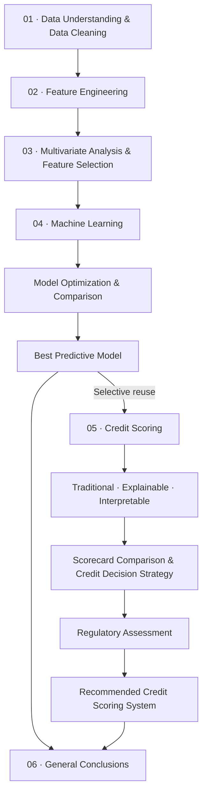

# Home Credit Risk Modeling

**Multivariate Statistics · Machine Learning · Credit Scoring**

An end-to-end research and portfolio project using the [Home Credit Default Risk dataset](https://www.kaggle.com/competitions/home-credit-default-risk) to predict credit risk and investigate how predictive models can support interpretable, auditable lending decisions.

## Research objectives

The project is organized into two sequential research tracks:

- **Machine Learning (primary):** determine which combination of financial features, multivariate statistical techniques, model-specific preprocessing, feature selection, and optimized algorithms delivers the strongest out-of-sample predictive performance.
- **Credit Scoring (complementary):** selectively reuse the findings and models from the first track to develop and compare traditional, explainable, and intrinsically interpretable scoring systems, taking the Mexican financial regulatory framework as a reference.

The best predictive model and the recommended credit scoring system need not be the same. The ML experiments are not restricted by the subsequent requirements of scorecard development.

## Methodology



| Stage | Research focus |
| --- | --- |
| 01 — Data Understanding & Cleaning | Data quality, missingness, anomalies, class imbalance, table integrity, and documented cleaning. |
| 02 — Feature Engineering | Financial ratios, repayment capacity, indebtedness, historical credit and payment aggregations. |
| 03 — Multivariate Analysis | Correlation, redundancy, PCA, clustering, Weight of Evidence (WOE), Information Value (IV), and exploratory feature selection. |
| 04 — Machine Learning | Model-specific preprocessing and selection, baseline models, hyperparameter tuning, cross-validation, ensembles, calibration, and predictive comparison. |
| 05 — Credit Scoring | Regulatory requirements, three scoring approaches, independent comparison, acceptance thresholds, economic scenarios, and regulatory gap analysis. |
| 06 — General Conclusions | Predictive winner, recommended scoring system, trade-offs, limitations, and future research. |

### Track 1 — Machine Learning

Candidate models include logistic regression, Random Forest, AdaBoost, Gradient Boosting, XGBoost, LightGBM, CatBoost, and Explainable Boosting Machines (EBM). Experiments will assess whether engineered features, PCA, clustering, WOE, or alternative feature subsets improve generalization. Each algorithm may use a different feature set and preprocessing pipeline.

ROC-AUC is the initial primary selection metric, supported by PR-AUC, KS, Gini, Brier score, log loss, and calibration analysis. The winning model will be selected using development validation, not the final holdout.

### Track 2 — Credit Scoring

| Approach | Proposed methodology |
| --- | --- |
| Traditional scorecard | Binning, WOE, IV, and logistic regression; fixed points per interval. |
| Explainable ML scorecard | Best predictive model and compatible SHAP explanations; individual score contributions with fidelity checks. |
| Interpretable ML scorecard | EBM or another additive model; nonlinear, interpretable feature contributions. |

The approaches will be compared on discrimination, calibration, stability, interpretability, parsimony, and credit decision utility. Gains tables, cutoff sensitivity, and hypothetical profit/loss scenarios (where financial inputs are unavailable) will connect predictions to lending decisions.

The regulatory work will review applicable Mexican banking provisions, including the CNBV's Circular Única de Bancos, establish a requirements matrix, and assess documented alignment and limitations. The project is a research prototype, not a CNBV-authorized model. The dataset's `TARGET` indicates payment difficulties; it is not assumed to match a Mexican regulatory definition of default.

## Repository structure

```text
home-credit-risk-ml/
├── data/                              # raw, interim, processed
├── docs/
│   ├── HOME_CREDIT_PROJECT_ROADMAP.md   # Detailed methodology and checklist
│   └── HomeCredit_columns_description.md
├── notebooks/
│   ├── 01_data_understanding_and_cleaning/
│   ├── 02_feature_engineering/
│   ├── 03_multivariate_analysis/       # Planned
│   ├── 04_machine_learning/
│   ├── 05_credit_scoring/              # Planned
│   └── 06_conclusions/                 # Planned
├── reports/                           # Generated analysis artifacts
├── src/credit_risk/                   # Reusable Python utilities
├── pyproject.toml                     # Package and dependencies
└── README.md
```

The tree reflects the reorganized development structure, including planned notebook stages. Empty directories and local generated artifacts may not appear on GitHub.

## Getting started

**Requirements:** Python 3.11, Git, and a Jupyter-compatible environment.

```bash
git clone https://github.com/estebanto7/home-credit-risk-ml.git
cd home-credit-risk-ml
```

Create a virtual environment and install the project in editable mode:

```powershell
# Windows PowerShell
py -3.11 -m venv .venv
.\.venv\Scripts\Activate.ps1
python -m pip install -e .
```

```bash
# macOS / Linux
python3.11 -m venv .venv
source .venv/bin/activate
python -m pip install -e .
```

Download the [competition data](https://www.kaggle.com/competitions/home-credit-default-risk/data) after accepting the Kaggle rules, and extract the files into `data/raw/`. Raw data and credentials must not be committed. Select the `.venv` interpreter and notebook kernel in VS Code or JupyterLab.

## Reproducibility and validation

- Preserve raw data and document every material statistical or financial decision.
- Use common development folds and a reserved labeled final holdout for both research tracks.
- Fit learned transformations and feature selection within training folds; choose models, calibrators, and decision thresholds using development data only.
- Review temporal leakage, class imbalance, potential bias, and feature availability at application time.
- Record seeds, configurations, selected features, dependencies, and evaluation results. Distinguish sample stability from temporal stability.

## Project status

**In development — Stage 01: Data Understanding & Data Cleaning.**

The initial data quality audit of the application training dataset has been implemented, including identifier and target checks, a stratified 80/20 split, and reporting utilities. Cleaning, feature engineering, multivariate analysis, and the two modeling tracks remain to be developed and validated. No final model performance or regulatory compliance is claimed.

For detailed tasks, research questions, experiment tracking, references, and methodological decisions, see the [Project Roadmap](docs/HOME_CREDIT_PROJECT_ROADMAP.md).
