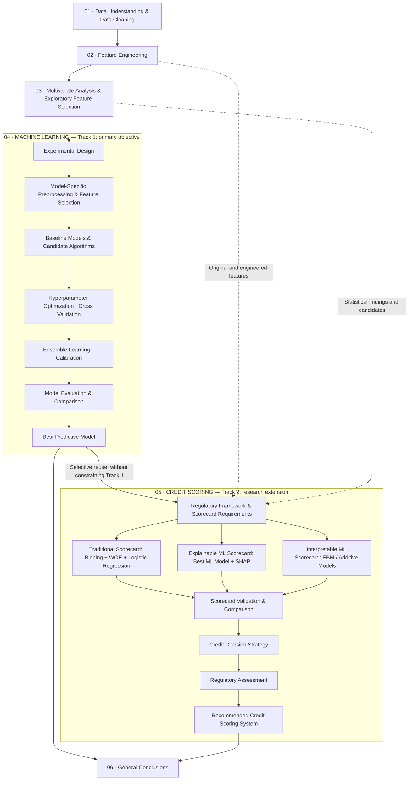

# Home Credit Default Risk — Project Roadmap

**Master methodology, checklist, and project continuity document**  
Project: `home-credit-risk-ml` · Version 1.0 · November 24, 2026

> This document records the agreed project structure. It is a working guide, not a results report. Checkboxes indicate tasks to verify or perform; they do not imply that everything is still pending in the repository. Update their status only after reviewing the notebooks and their results. The numbering identifies methodological stages, not necessarily individual files.

## 0. Project Purpose and Agreements

### Primary Objective — Machine Learning

Develop, compare, and optimize machine learning models for predicting credit risk in Home Credit Default Risk, evaluating the impact of feature engineering, multivariate statistical analysis, feature selection, and hyperparameter optimization on out-of-sample performance.

**Primary research question:** Which combination of features, preprocessing, feature selection, and models achieves the best predictive performance for credit risk?

### Complementary Objective — Credit Scoring

Develop and compare traditional, explainable, and intrinsically interpretable credit scoring systems, selectively reusing the data, features, models, and findings from the machine learning research track, and assessing their alignment with the Mexican financial regulatory framework.

**Complementary research question:** How can the predictive power of machine learning models be translated into an interpretable, stable, and auditable credit scoring system without unnecessarily sacrificing performance?

### Non-negotiable Methodological Principles

- **Sequence:** develop the Machine Learning track first, then develop the Credit Scoring track. They are not two parallel branches from the outset.
- **Experimental freedom:** do not constrain the first track to features, transformations, or algorithms that are convenient for a scorecard. Binning, WOE, PCA, interactions, and feature selection are alternatives to evaluate, not universal requirements.
- **Selective reuse:** the second track can recover elements from any of the first four stages, not just the winning model. It may return to the original features, perform its own transformations, and refit models when justified.
- **Independent comparisons:** Model Evaluation & Comparison belongs to Machine Learning; Scorecard Validation & Comparison belongs to Credit Scoring. The two tracks may produce different recommendations.
- **Justification:** every procedure must address a question, have a statistical or financial rationale, and provide evidence. Do not apply techniques merely to include them in the project.
- **Regulation:** study the regulatory framework at the beginning of Credit Scoring and assess alignment at the end of that track. Relevant cross-cutting legal and ethical requirements (e.g., privacy, non-discrimination, and data availability) must not be postponed.
- **Honest evaluation:** do not select features, models, transformations, thresholds, or scorecards using the final test set. Do not fabricate results or present regulatory compliance as certified.

## 0.1. Overall Workflow

**Reading the workflow:** stages 01–03 establish the common foundation; stage 04 selects the best predictive model using development data only; stage 05 develops three scoring approaches with their own criteria; stage 06 integrates the findings. Dotted arrows represent elements that may be recovered, not mandatory reuse.

If the Markdown viewer does not support Mermaid, the equivalent sequence is: `01 → 02 → 03 → 04 (ML and model comparison) → 05 (Credit Scoring and scorecard comparison) → 06 (conclusions)`.

## 0.2. Cross-cutting Experimental Design Protocol

Define data partitions **before any supervised transformation or data-driven decision that may influence the model**, even though the formal Experimental Design section appears in stage 04.

- [ ] Define the unit of analysis (applicant/loan), target variable `TARGET`, prediction time, and study population.
- [ ] Distinguish labeled development data from the Kaggle test file, which does not contain `TARGET`.
- [ ] Create and persist a labeled, independent final holdout shared by both tracks. Use stratification where appropriate; if customers appear more than once, prevent the same customer from appearing in multiple partitions.
- [ ] Define common development folds, random seed, primary metrics, search budget, and comparison protocol. Save partition identifiers.
- [ ] Fit imputation, scaling, encoding, binning, WOE, IV, PCA, selection, and any learned transformation exclusively on the training data of each fold. Apply fitted objects to validation data without recalculating them using its labels.
- [ ] Use cross-validation for selection and tuning; consider nested validation or another independent internal partition if a less optimistic estimate is needed after extensive searches.
- [ ] For calibration, stacking, distillation, or threshold selection, use out-of-fold predictions or independent development subsets as appropriate to the method.
- [ ] Keep the holdout closed while designing both tracks. Select the ML winner reused in Credit Scoring through development validation, not the holdout. Evaluate the previously fixed final candidates on the holdout once both tracks are ready; do not refit based on those results.
- [ ] Audit temporal leakage: use only information available at the application date; verify aggregation windows for historical tables.
- [ ] Do not claim temporal stability or out-of-time (OOT) validation if reliable dates or chronological cohorts are unavailable. Random splits allow assessment of sample stability, not necessarily temporal stability.
- [ ] Record seeds, library versions, parameters, features, partitions, metrics, and decisions for reproducibility.

---

# 01. Data Understanding & Data Cleaning

**Objective:** understand what each table and variable represents, identify data quality issues, and produce consistent data without making irreversible modeling decisions at this stage.

## 1.1. Data Understanding

- [ ] Inventory the available Home Credit tables and consult their original descriptions.
- [ ] Identify granularity, keys, cardinalities, relationships, and possible duplicates (e.g., `SK_ID_CURR`, `SK_ID_PREV`, `SK_ID_BUREAU`, depending on the table).
- [ ] Understand the definition of `TARGET`, its known horizon, and its limitations; do not automatically equate it with a Mexican regulatory twelve-month default definition.
- [ ] Identify the financial meaning and units of variables, special values, and when each variable becomes available.
- [ ] Determine which tables and columns will be used, which require review, and which will not be available at prediction time.

## 1.2. Exploratory Data Analysis (EDA)

- [ ] Review dimensions, data types, distributions, quantiles, cardinality, and `TARGET` imbalance in development data.
- [ ] Visualize distributions and preliminary relationships between features and default.
- [ ] Analyze missing-value patterns, extreme values, and infrequent categories.
- [ ] Formulate explanatory hypotheses, distinguishing statistical association from causation.

## 1.3. Data Quality

- [ ] Verify referential integrity, key uniqueness, duplicate records, and consistency across tables.
- [ ] Detect impossible values, special missing-value codes, inconsistent signs/dates, and incompatible units.
- [ ] Distinguish structural missingness, absence of credit history, and genuinely unknown data.
- [ ] Review features susceptible to leakage, post-origination information, and sensitive variables or potential proxies.
- [ ] Create an issue log: variable, finding, evidence, impact, and proposed treatment.

## 1.4. Data Cleaning

- [ ] Apply justified corrections and document them; preserve original data or reproducible snapshots.
- [ ] Standardize data types, formats, and missing-value codes.
- [ ] Resolve duplicates and anomalies according to the actual granularity of each table.
- [ ] Do not indiscriminately impute or remove valid outliers; leave algorithm-dependent treatments to the relevant pipelines.
- [ ] Validate before/after counts, key integrity, and the absence of unjustified data loss.
- [ ] Save clean tables and the updated data dictionary.

**Deliverable / completion criterion:** reusable clean tables, data quality assessment, dictionary, cleaning rules, and documented limitations.

---

# 02. Feature Engineering

**Objective:** transform application, previous credit, bureau, and payment history information into useful features for explaining and predicting risk; retain eligible original features so each model can determine how to use them.

## 2.1. Financial Ratios

- [ ] Construct candidate measures of repayment capacity, financial burden, solvency, and indebtedness.
- [ ] Consider credit-to-income, annuity-to-income, outstanding-debt-to-income, and actual-to-scheduled-payment ratios when units and sources permit.
- [ ] Explicitly handle zero denominators, missing values, and time units; do not assume a column name guarantees its periodicity.
- [ ] Analyze the financial rationale and empirical behavior of each ratio.

## 2.2. Historical Aggregations

- [ ] Define applicant-level aggregations from eligible tables: bureau records, previous loans, installments, balances, and historical behavior.
- [ ] Evaluate the frequency, severity, and recency of arrears; exposure, utilization, balances, and payment behavior.
- [ ] Experiment with counts, proportions, means, maxima, dispersion, trends, and historical windows consistent with the application date.
- [ ] Distinguish lack of history from a history with zero events; verify the economic meaning of null values.
- [ ] Check join cardinality and avoid multiplying rows or including future information.

## 2.3. Feature Construction

- [ ] Build a feature dataset at the prediction-unit level, with keys and `TARGET` separated from predictors.
- [ ] Evaluate candidate transformations: logarithms, ratios, missingness indicators, interactions, and other justified representations.
- [ ] Retain a baseline version without mandatory binning/WOE. WOE can be tested as an alternative representation during ML and developed specifically during Credit Scoring.
- [ ] Review distributions, consistency, and redundancy of engineered features.
- [ ] Record any transformation that must be fitted within each fold rather than materialized globally.

## 2.4. Feature Documentation

- [ ] Create a feature catalog: name, description, source table/columns, formula, granularity, unit, time window, null treatment, and financial rationale.
- [ ] Record hypotheses about relationships with risk (increasing, decreasing, nonlinear, or unknown), without imposing them in the absence of evidence.
- [ ] Flag potential risks of bias, leakage, or difficulty of interpretation.
- [ ] Version the feature matrix and feature construction functions.

**Deliverable / completion criterion:** reproducible feature dataset, feature catalog, and construction functions ready for pipelines. Model-dependent transformations remain optional.

---

# 03. Multivariate Analysis & Feature Selection

**Objective:** understand the statistical structure of the features and identify useful candidates, redundancies, and patterns. This is an exploratory stage; it must not impose a single feature set on all models.

## 3.1. Correlation & Redundancy

- [ ] Analyze correlations appropriate to the data type (Pearson, Spearman, or other relevant measures).
- [ ] Identify groups of redundant variables and review their financial interpretation, availability, and quality.
- [ ] Distinguish correlation between predictors from association with `TARGET`.
- [ ] Evaluate constant, near-constant, duplicate, and potential proxy variables; justify any universal exclusion.

## 3.2. Principal Component Analysis (PCA)

- [ ] Select the relevant numerical subset and define missing-value treatment and scaling.
- [ ] Analyze explained variance, loadings, relationships between components, and multivariate structure.
- [ ] Interpret components and consider using them as additional features or for dimensionality reduction only if they add value.
- [ ] Compare performance with and without PCA when relevant; fit PCA within the training pipeline.
- [ ] Do not require a scorecard to use components if they complicate financial interpretation.

## 3.3. Cluster Analysis

- [ ] Define which customer profiles or structures to investigate and which variables are relevant.
- [ ] Evaluate methods, distances, and number of clusters using separation, stability, and interpretation criteria.
- [ ] Analyze profiles and default rates in development data, avoiding the use of `TARGET` to construct unsupervised clusters.
- [ ] If clusters are used as predictors, define how new customers are assigned and validate their out-of-sample utility; avoid selection using the holdout.
- [ ] Do not retain clustering as a feature if there is no evidence of its utility.

## 3.4. Information Value (IV) & Weight of Evidence (WOE)

- [ ] Define a WOE convention (bad/good) and calculate distributions, default rates, WOE, and IV.
- [ ] Compare frequency-based binning, financially meaningful cutoffs, and trees or supervised optimization, when appropriate.
- [ ] Evaluate bin size, representation of both classes, missing values, smoothing, reasonable monotonicity, and cutoff stability.
- [ ] Use IV as evidence of univariate discrimination; do not treat empirical thresholds as laws or automatically discard low-IV variables.
- [ ] Investigate unusually high IV as a potential leakage signal, without assuming it necessarily indicates leakage.
- [ ] Estimate all cutoffs and WOE exclusively on each fold's training data if incorporated into modeling.

Using the convention studied in class, for bin i:

$$
 d_{b,i}=\frac{n_{b,i}}{N_b},\quad d_{g,i}=\frac{n_{g,i}}{N_g},\quad WOE_i=\ln\left(\frac{d_{b,i}}{d_{g,i}}\right),\quad IV=\sum_i(d_{b,i}-d_{g,i})WOE_i.
$$

The bin default rate is $n_{b,i}/(n_{b,i}+n_{g,i})$; do not confuse it with $d_{b,i}$.

## 3.5. Exploratory Feature Selection

- [ ] Consolidate findings on quality, correlation, PCA, clustering, IV, and financial rationale.
- [ ] Identify eligible variables, candidates for reduction, candidates for transformation, and variables that must be excluded due to leakage or invalidity.
- [ ] Prepare feature scenarios without aggressively removing variables solely because of low individual association or high correlation.
- [ ] Keep eligible original features available to models that exploit nonlinear relationships or interactions.

**Deliverable / completion criterion:** documented multivariate analysis, hypotheses, and candidate feature sets; not a definitive selection shared by all models.

---

# 04. Machine Learning — Primary Research Track

**Objective:** find the best predictive model under a reproducible experimental design. Each algorithm may use its own feature representation and feature set. This track is not constrained by the subsequent development of scorecards.

## 4.1. Experimental Design

- [ ] Confirm the cross-cutting protocol in section 0.2 before beginning the experiments.
- [ ] Define ROC-AUC as the initial primary metric (consistent with the competition), with PR-AUC, KS, Gini, and calibration metrics as complementary measures; establish the selection criterion before consulting final results.
- [ ] Establish a simple baseline and comparison conditions: common folds, seeds, search budget, resources, and strategy for handling class imbalance.
- [ ] Define how to evaluate the gains from feature engineering, PCA, WOE, clustering, and feature selection through controlled comparisons or ablations.
- [ ] Record hypotheses, experimental configurations, and rules for deciding when an improvement is meaningful.

## 4.2. Model-Specific Preprocessing

- [ ] Design pipelines according to the assumptions and capabilities of each model family.
- [ ] Evaluate imputation, scaling, categorical encoding, transformations, native missing-value handling, and outlier treatment where appropriate.
- [ ] Consider original features, engineered features, and alternative representations (WOE, principal components, cluster membership indicators, interactions), without assuming a universal transformation.
- [ ] Evaluate WOE experimentally: original/engineered features versus WOE versus a selective combination, if there is a clear hypothesis. Trees can learn their own splits; WOE may regularize relationships or lose information.
- [ ] Compare class imbalance treatments when relevant; do not automatically apply SMOTE or class weighting. Verify the impact on probability calibration.
- [ ] Fit each transformation within the folds and save its complete pipeline.

## 4.3. Model-Specific Feature Selection

A feature may contribute little to an untransformed linear logistic regression but provide substantial information to a tree-based model that captures nonlinear relationships and interactions. Therefore, there is no requirement to use the same features in every model.

| Family | Candidate methods (not mandatory) |
|---|---|
| Logistic Regression | LASSO, Elastic Net, VIF as a diagnostic, Stepwise/AIC for comparison, nonlinear transformations |
| Random Forest | Permutation Importance, RFE, Boruta |
| AdaBoost / Gradient Boosting | Importance, permutation, iterative selection |
| XGBoost / LightGBM | Gain Importance, SHAP, permutation, and iterative selection |
| CatBoost | Feature Importance, SHAP, recursive selection |
| EBM | Term importance and analysis of learned functions |

- [ ] Compare three scenarios, subject to available resources: A) all eligible features; B) a subset proposed by the exploratory analysis; C) model-specific feature selection.
- [ ] Evaluate selection on validation data, not just through importance measures within training data; importance measures can be sensitive to correlation and cardinality.
- [ ] Incorporate feature selection, preprocessing, and tuning as parts of the same experimental design where appropriate.
- [ ] Record selected features, stability across folds, performance gains/losses, and reduction in complexity.
- [ ] Do not force a different selection method for each model if it provides no demonstrable benefit.

## 4.4. Baseline Models

- [ ] Implement a simple baseline (e.g., logistic regression) and compare it with a trivial prevalence-based reference when useful for contextualizing metrics.
- [ ] Train machine learning candidates: Logistic Regression, Random Forest, AdaBoost, Gradient Boosting, XGBoost, LightGBM, CatBoost, and EBM; expand or narrow the list according to evidence and budget.
- [ ] Record performance, training time, inference time, number of features, and initial configuration.
- [ ] Compare validation results before tuning to prioritize models; do not declare a winner based on a single favorable split.

## 4.5. Hyperparameter Optimization

- [ ] Define hyperparameters and search ranges based on each algorithm: regularization, depth, learning rate, number of trees, sampling, and other relevant parameters.
- [ ] Select a search strategy (grid, random, Bayesian/Optuna, or another) and comparable or explicitly justified budgets.
- [ ] Use cross-validation and early stopping correctly, without using the holdout for any decision.
- [ ] Analyze learning curves, variability across folds, overfitting, and computational cost.
- [ ] Save hyperparameters, trial results, seeds, and the rationale for the final configuration.

## 4.6. Ensemble Learning

- [ ] Investigate whether voting, blending, stacking, or other ensembles improve upon the best individual models.
- [ ] Analyze diversity and complementarity of model errors.
- [ ] Use out-of-fold predictions to train meta-models and avoid information leakage.
- [ ] Compare the ensemble with individual models under the same protocol; retain it only if the improvement justifies it.

## 4.7. Model Calibration

- [ ] Analyze whether estimated probabilities correspond to observed frequencies of `TARGET`.
- [ ] Evaluate calibration curves, Brier Score, Log Loss, and mean PD versus observed rate; consider calibration intercept and slope.
- [ ] Compare sigmoid/Platt calibration, isotonic calibration, or other suitable alternatives if needed, using independent internal data or out-of-fold predictions.
- [ ] Save the calibrator alongside the pipeline and distinguish the original model output from the calibrated probability.
- [ ] Do not assume that a higher-AUC model produces better probabilities.

## 4.8. Model Evaluation & Comparison

This comparison belongs exclusively to the Machine Learning track. Do not select the best scoring system here or penalize a model merely because it is difficult to convert into a scorecard.

- [ ] Compare ROC-AUC, PR-AUC, KS, Gini, Brier Score, Log Loss, and performance across folds.
- [ ] Evaluate sensitivity, specificity, precision, recall, F1, and balanced accuracy when a threshold has been fixed using development data.
- [ ] Analyze training/validation gaps, sample stability, metric uncertainty, and sensitivity to feature representations.
- [ ] Compare improvements from feature engineering, feature selection, tuning, calibration, and ensembles against their respective references.
- [ ] Evaluate complexity and computational cost as complementary criteria; do not impose intrinsic interpretability as a condition for winning this track.
- [ ] Rank models using development metrics, considering practically meaningful differences rather than merely decimal differences in AUC.

## 4.9. Best Predictive Model

- [ ] Select the best predictive candidate based on development evidence, without predetermining that it will be XGBoost.
- [ ] Refit the pipeline and calibration under the established protocol; freeze the configuration, features, transformations, and model version.
- [ ] Save the model, pipeline, development predictions, calibrator, metrics, fold identifiers, and reproducible documentation.
- [ ] Also preserve the best interpretable model, reference logistic regression, and other relevant candidates for Credit Scoring.
- [ ] Explain the selection using XYZ: X = evidence-supported finding; Y = reasoned explanation or hypothesis; Z = implication for the project.
- [ ] Report final performance of the frozen candidates on the common holdout at the end of both tracks, without refitting based on it.

**Deliverable / completion criterion:** predictive winner selected using development data, comparable experiments, reusable models and pipelines, evidence, and limitations. The winner does not have to be interpretable by construction.

---

# 05. Credit Scoring — Second Research Track

**Objective:** investigate how to turn the results of the first track into a credit scoring system, develop three approaches, and evaluate their predictive performance, calibration, stability, interpretability, parsimony, financial utility, and regulatory alignment.

The intended application is an **Application Scorecard**: assess an applicant before granting credit. This differs from a Behavioral Scorecard (monitoring throughout the life of the loan) and a Collection Scorecard (collections).

### Bridge Between Machine Learning and Credit Scoring

| Element from previous stages | Action in Credit Scoring |
|---|---|
| Clean data | Reuse as the common foundation. |
| Original and engineered features | Reuse eligible features; perform feature selection again if necessary. |
| Multivariate analysis, exploratory WOE/IV | Recover findings, not necessarily fitted objects or cutoffs. |
| Folds and holdout | Maintain the common design. Do not open the holdout to redesign the track. |
| Best predictive model | Recover its complete pipeline to explain its predictions, if feasible. |
| Logistic regression from the ML track | Recover as a reference; refit with WOE if required by the traditional scorecard. |
| EBM/additive models | Recover or refit to a scorecard-compatible structure. |
| Feature selection, PCA, interactions | Reassess according to interpretability, parsimony, evidence, and purpose. |
| Binning and WOE | Develop specifically for the traditional scorecard; do not require them for the complex model. |

**Rule:** do not reuse elements out of obligation. Each scoring model may require different preprocessing, feature sets, or models. If the predictive winner cannot be explained satisfactorily, document the limitation and evaluate alternative candidates without retrospectively altering the outcome of the ML track.

## 5.1. Regulatory Framework & Scorecard Requirements

Study the regulations before deciding how to construct and compare the scorecards. The previous review was preliminary; this section establishes tasks, not a certification of compliance.

- [ ] Define the type of institution and intended use to simulate: consumer credit origination at a Mexican credit institution as an initial reference; verify applicability.
- [ ] Consult current official sources (CNBV, DOF, applicable legislation) and record the consultation date, version, article, subsection, and link.
- [ ] Review Article 15 of the Circular Única de Bancos (CUB), particularly the provisions relevant to parametric assessment and granting of consumer credit.
- [ ] Distinguish credit origination from internal prudential models; review Annex 15 of the CUB as a reference for validation and documentation where relevant, without automatically transferring its obligations to another use.
- [ ] Verify whether specific restrictions on algorithms, explainability, data use, documentation, authorization, validation, and monitoring apply to the chosen scenario. Do not assume that only logistic regression is permitted or that SHAP constitutes regulatory approval.
- [ ] Review relevant obligations concerning personal data protection, non-discrimination, and use of credit information.
- [ ] Formulate scorecard criteria: traceability, consistency, reproducibility, predictive quality, calibration, stability, financial rationale, and understandable explanations, distinguishing obligations from good practices.
- [ ] Create a traceability matrix: provision, exact quotation, requirement, applicability, required evidence, project procedure, and limitation.
- [ ] Acknowledge Home Credit's limitations: the population does not demonstrate Mexican representativeness, the definition of `TARGET` does not specify all default parameters, and temporal validation or institutional authorization is not established.

## 5.2. Traditional Scorecard — Logistic Regression + WOE

**Objective:** build a traditional, transparent, and auditable reference model with fixed points for each feature interval.

- [ ] Select features with financial relevance, availability at origination, and evidence of utility.
- [ ] Compare binning (fine classing and coarse classing), WOE, IV, interval sizes, and monotonicity where justified.
- [ ] Treat missing values and bins with zero good/bad observations consistently; compare scenarios if exclusion based on missingness is questionable.
- [ ] Select features and fit logistic regression with WOE; review signs, multicollinearity, stability, parsimony, calibration, and incremental contribution.
- [ ] Define a common score scale: reference score, reference good-to-bad odds, and PDO. The classroom values (600, 20:1, 50) are an example, not a regulatory obligation.
- [ ] Construct and verify the points table by interval and its equivalence to the model prediction (except for explicit rounding).
- [ ] Apply the scorecard to customers, document illustrative cases, and generate individual explanations.

Let $p(x)$ be the probability of `TARGET = 1`, $Z(x)=\log[p(x)/(1-p(x))]$, $F=PDO/\ln(2)$, and $A=S_0-F\ln(O_0)$, where $O_0$ denotes the reference **good-to-bad** odds:

$$
S(x)=A-FZ(x)=A-F\beta_0- F\sum_j\beta_j WOE_j(x_j).
$$

The contribution of each feature is $-F\beta_j WOE_j(x_j)$. If post-model calibration is applied, verify whether it preserves the additive decomposition; document any changes or approximations.

## 5.3. Explainable ML Scorecard — Best Predictive Model + SHAP

**Objective:** leverage the predictive performance of the ML winner and obtain explainable individual contributions, without imposing prior binning if the model does not require it.

- [ ] Recover the frozen pipeline of the winning model, its calibrator, and the features used.
- [ ] Choose a compatible explanation technique (e.g., TreeSHAP for tree boosting) and document the output scale, reference/background, and treatment of dependencies between predictors.
- [ ] Analyze global and local explanations; verify contribution stability, interactions, correlated variables, and financial consistency.
- [ ] Construct a score from probabilities and, if the model supports an additive decomposition of the logit, convert the contributions into individual points.
- [ ] Numerically verify that base points plus contributions reproduce the original score on the explained scale.
- [ ] If calibration is nonlinear or SHAP explains a different scale, do not assume that the same decomposition reproduces the calibrated score; choose a compatible explanation or measure and document approximation error.
- [ ] Generate customer examples, identify the main factors increasing/decreasing risk, and define communication criteria; SHAP explains model behavior, not the causality or fairness of a decision.
- [ ] If investigating a static points table by bins, treat it as a separate approximate model and measure fidelity, discrepancies, and predictive performance loss.

If SHAP exactly decomposes the logit used in the score:

$$
Z(x)=\phi_0+\sum_j\phi_j(x),\qquad S(x)=A-F\phi_0-F\sum_j\phi_j(x).
$$

Unlike the traditional scorecard, points per feature may depend on a customer's other characteristics. Therefore, an additive individual explanation does not turn the underlying model into a white box or guarantee universal points per interval.

## 5.4. Interpretable ML Scorecard — EBM and Additive Models

**Objective:** learn nonlinear relationships using an intrinsically interpretable model and assess whether it retains sufficient predictive power relative to complex models.

- [ ] Recover or train an Explainable Boosting Machine (EBM) with an additive structure without interactions as the initial reference.
- [ ] Evaluate term selection, internal binning, learned functions, regularization, stability, and parsimony.
- [ ] Analyze the effects of each feature and, where appropriate, impose justified monotonicity constraints; compare against the unconstrained model.
- [ ] Transform logit contributions into fixed points per term/interval and verify their sum.
- [ ] Experiment with a limited number of interactions only if the improvement justifies them; document that their points depend on combinations of variables.
- [ ] Consider Add-XGBoost or distillation (an additive student model approximating the winner) as optional extensions, not mandatory commitments. If applied, measure fidelity as well as actual predictive performance.

For a purely additive EBM:

$$
Z(x)=\beta_0+\sum_j f_j(x_j),\qquad S(x)=A-F\beta_0-F\sum_j f_j(x_j).
$$

The functions $f_j$ allow nonlinear relationships without relying on post-hoc explanations. In a binned additive model, their contributions can be represented as a points table.

## 5.5. Scorecard Validation & Comparison

This comparison belongs to Credit Scoring. The objective is not necessarily to select the highest AUC, but to justify which scoring system is most appropriate for credit assessment.

- [ ] Establish a common score scale and risk conventions; compare probabilities and scores in the same population and partitions.
- [ ] Evaluate discrimination: ROC-AUC, PR-AUC, KS, Gini, and separation across risk levels.
- [ ] Evaluate calibration: Brier Score, Log Loss, calibration curves, and differences between estimated PD and observed rates by group.
- [ ] Evaluate the stability of scores and features using PSI and analysis of bins, coefficients, or functions. Use justified references and thresholds; do not confuse sample PSI with temporal stability.
- [ ] Verify PD-score equivalence and explanation fidelity; analyze rounding and approximation effects.
- [ ] Compare the number of features/terms, number of bins, interactions, cost, ease of auditing, consistency, and reproducibility.
- [ ] Evaluate financial consistency, potential biases, and proxies; compare performance, calibration, and decision rates across groups when the data and applicable framework permit.
- [ ] Analyze predictive differences relative to the ML winner and determine whether any loss or improvement justifies the difference in complexity and interpretability.
- [ ] Select scoring candidates using development data and establish comparison rules before accessing the holdout.

| Criterion | Traditional | Explainable ML | Interpretable ML |
|---|---|---|---|
| Model | Logistic regression + WOE | ML winner + compatible SHAP | EBM/additive model |
| Intrinsic interpretability | Yes, for an additive structure | Not necessarily | Yes, for a documented additive structure |
| Fixed points per interval | Yes | Not necessarily; individual contributions | Yes, without interactions and with defined bins |
| Nonlinearity | Through transformations/bins | Model-dependent | Learned functions |
| Comparison | Empirical evidence | Empirical evidence | Empirical evidence |

## 5.6. Credit Decision Strategy

- [ ] Build a Gains Table by score level and calculate cumulative acceptance, rejection, detected bad borrowers, and default rates among accepted applicants.
- [ ] Analyze the consequences of different cutoffs: approval, portfolio risk, false positives, false negatives, and opportunity cost.
- [ ] Use statistical criteria on development data, such as KS, F1, or others, specifying the objective and score direction; do not optimize thresholds on test data.
- [ ] If sufficient financial information exists, formulate an expected profit/cost function and evaluate economically motivated cutoffs.
- [ ] If reliable EAD, LGD, cost, or profitability data are unavailable, use explicitly hypothetical scenarios; do not claim actual profitability or an economically optimal cutoff.
- [ ] Distinguish the maximum individual PD from the expected default rate of the entire accepted portfolio.
- [ ] Fix the cutoff policy on development data, verify it in the final evaluation, and document assumptions and limitations.

As a simplified example, if the net benefit of a good loan is $B$, the net loss of a bad loan is $L$, and rejection yields zero benefit, accept when $(1-p)B-pL\geq0$, equivalently $p\leq B/(B+L)$. This example requires calibrated probabilities and explicit assumptions.

## 5.7. Regulatory Assessment

- [ ] Return to the requirements matrix prepared in 5.1 and link each criterion to concrete evidence.
- [ ] Review documentation of algorithms, features, assumptions, decisions, validation, calibration, consistency, and explanations.
- [ ] Distinguish applicable requirements, good practices, and elements outside the prototype's scope.
- [ ] Classify evidence as substantiated, partial, pending, not applicable, or unverifiable, with justification.
- [ ] Identify information gaps (representativeness, default definition, dates, monitoring, governance, financial data, institutional documentation).
- [ ] Propose actions necessary for real-world implementation and a monitoring framework: drift, calibration, performance, population changes, and review and approval of changes.
- [ ] Do not equate documentary or methodological alignment with comprehensive legal compliance or CNBV authorization.

## 5.8. Recommended Credit Scoring System

- [ ] Recommend a scoring approach based on the defined criteria, justifying trade-offs and limitations.
- [ ] Freeze candidates, calibrators, scale, and decision rules before evaluating the common holdout; report final metrics without retuning.
- [ ] Save the scorecard or contribution system, pipeline, scale, cutoff policies, validations, individual examples, and regulatory documentation.
- [ ] Formulate a Credit Scoring-specific XYZ conclusion; distinguish the predictive winner from the recommended scoring system.

**Deliverable / completion criterion:** three approaches developed and compared, a justified credit strategy, a regulatory matrix, and an evidence-supported recommendation. The result is a research prototype, not an authorized financial product.

---

# 06. General Conclusions

## 6.1. Machine Learning Conclusions

- [ ] Answer the primary research question: which features, selection methods, algorithms, and configurations achieved the greatest predictive power.
- [ ] Quantify the contribution of feature engineering, multivariate analysis, tuning, calibration, and ensembles using comparable results.
- [ ] Identify the predictive winner and report the final evaluation, uncertainty, stability, and limitations.

## 6.2. Credit Scoring Conclusions

- [ ] Answer the complementary research question: which alternative achieves the best balance of performance, interpretability, stability, calibration, parsimony, and credit assessment utility.
- [ ] Explain the differences between a traditional scorecard, individual black-box explanations, and an interpretable additive model.
- [ ] Justify the recommended system and its cutoff strategy without overstating regulatory alignment.

## 6.3. Integrated Discussion

- [ ] Compare the best predictive model and the recommended scorecard; they may differ, and this is not a contradiction.
- [ ] Quantify the predictive cost of interpretability constraints, if any, and discuss its practical relevance.
- [ ] Identify which ML findings or artifacts were reused and which had to be rebuilt.
- [ ] Integrate results using XYZ: evidence-supported observation, plausible explanation, and implication; distinguish evidence from hypotheses.

## 6.4. Limitations & Future Research

- [ ] Explicitly state limitations of the dataset, `TARGET` definition, representativeness, temporal validation, availability of financial data, and regulatory assessment.
- [ ] Propose future research based on the findings: OOT validation, Mexican data, alternative additive models, distillation, monitoring, fairness, and economic decision-making.
- [ ] Deliver reproducible documentation, conclusions, and final references.

---

# 07. Research Questions and Decision Criteria

These questions guide the organization of experiments; they do not require running every possible combination. Prioritize those with the greatest relevance and feasibility.

| ID | Research question | Evidence / criterion |
|---|---|---|
| ML-01 | Does feature engineering add value relative to the original dataset? | Ablation and validation comparison. |
| ML-02 | Do PCA, clustering, or WOE provide useful information? | Experiments with and without each representation. |
| ML-03 | Does model-specific feature selection outperform common selection or the full feature set? | Metrics, stability, and number of features. |
| ML-04 | Which model family and optimized configuration generalize best? | Metrics on common folds and uncertainty. |
| ML-05 | Do ensembles or calibration provide additional value? | Comparison with individual/uncalibrated candidates. |
| CS-01 | How does the logistic scorecard compare with the ML winner? | Discrimination, calibration, and complexity. |
| CS-02 | Can we explain the winning model's score using faithful contributions? | Numerical equivalence, stability, and individual explanations. |
| CS-03 | Can EBM or another additive model compete with a black box? | Performance, parsimony, and learned functions. |
| CS-04 | Do monotonicity constraints improve consistency without excessive loss? | Constrained/unconstrained comparison and financial rationale. |
| CS-05 | Which cutoff is defensible? | Gains Table, metrics, and economic scenarios. |
| CS-06 | What regulatory alignment can actually be documented? | Requirements matrix and gap analysis. |
| INT-01 | How much predictive power is gained or lost when interpretability is required? | Comprehensive comparison of both tracks, without declaring a winner based on AUC alone. |

---

# 08. Project Management and Continuity

## 8.1. Notebook Conventions

Maintain the working style of the multivariate analysis projects: numbered sections and subsections, clear objectives, explanatory Markdown before code, short and readable cells, mathematical foundations only where they improve understanding, interpreted tables and charts, and XYZ conclusions. Avoid redundant code or duplicated results without a purpose.

- [ ] Review existing notebooks before renaming or creating files.
- [ ] Define an objective and deliverable for each notebook; a stage may span multiple notebooks.
- [ ] Keep reusable functions in modules where convenient, and parameters/seeds in an identifiable configuration.
- [ ] Document the rationale behind decisions and compare scenarios before committing to changes that affect the methodology.
- [ ] Preserve versioned intermediate artifacts, with reproduction instructions and notebook dependencies.
- [ ] Do not replace or remove previous work without verifying its contents and deciding what to retain.

## 8.2. Artifacts to Persist

The following names describe contents, not a definitive directory structure. Adapt them to the actual repository.

| Stage | Output artifacts |
|---|---|
| 01 | Clean tables, data dictionary, quality log, and cleaning rules |
| 02 | Feature dataset, catalog, aggregation functions |
| 03 | Diagnostics, hypotheses, candidate feature sets, and exploratory results |
| 04 | Partitions, pipelines, trials, OOF metrics, frozen models, calibrators, ML winner |
| 05 | Regulatory framework and matrix, three scorecards, explanations, comparison, cutoff policy, recommendation |
| 06 | Common final evaluation, independent and integrated conclusions, limitations, and references |

## 8.3. Executive Progress Checklist

Mark a stage as complete only when its completion criterion is met. Mark irrelevant tasks as `N/A` with justification instead of performing them out of obligation.

- [ ] 01 — Data Understanding & Data Cleaning
- [ ] 02 — Feature Engineering
- [ ] 03 — Multivariate Analysis & Feature Selection
- [ ] 04 — Machine Learning: optimized models and winner selected on development data
- [ ] 05 — Credit Scoring: three approaches, comparison, cutoff, regulatory alignment, and recommended system
- [ ] 06 — General Conclusions: final evaluation and integration

## 8.4. Decision Log

| Date | Stage / notebook | Question or issue | Alternatives | Decision and rationale | Evidence / file | Status |
|---|---|---|---|---|---|---|
| 2026-11-24 | Roadmap | Integrate Credit Scoring without constraining ML | Parallel vs. sequential | Sequential; independent comparisons and selective reuse | Conversation agreement / this document | Agreed |
| | | | | | | |

## 8.5. Experiment Log

| ID | Hypothesis | Dataset / features | Pipeline / model | Folds / seed | Parameters | Development metrics | Result / decision |
|---|---|---|---|---|---|---|---|
| | | | | | | | |

## 8.6. Current Status and Next Session

Update this block at the end of each session. The methodological roadmap does not replace verification of the repository.

- **Current stage:** to be confirmed against the actual repository version; the previous agreement placed the project in Data Understanding & Data Cleaning.
- **Last notebook worked on:** to be recorded.
- **Last completed and verified task:** to be recorded.
- **Changes made:** to be recorded.
- **Available artifacts (paths/versions):** to be recorded.
- **Important findings:** to be recorded.
- **Pending decisions:** to be recorded.
- **Blockers / errors:** to be recorded.
- **Next concrete task:** review the status of the current stage and continue from the first relevant pending task.

## 8.7. Instructions for Resuming the Project in Another Chat

Share this file together with the current notebook, repository link, or required results. Suggested prompt:

> This is the master roadmap for my Home Credit project. Read it as the methodological reference and respect the agreed two sequential research tracks. First review the actual status of the repository/notebook and the progress log. Do not assume unverified tasks are complete. I want to resume from the indicated stage, working section by section, with statistical and financial justification, clear code, and XYZ conclusions. Before changing the scope, structure, or a significant methodological decision, explain the alternatives and their rationale. Do not modify the ML track solely to facilitate Credit Scoring. At the end, record what was completed, what was decided, and the next step.

---

# 09. Initial References and Verification Tasks

Starting points from the previous discussion. Before using them as definitive foundations, verify the current regulatory text, bibliographic metadata, applicability, methodology, and results in the original sources. Expand the bibliography when there is a specific question; do not assume that a technique is authorized merely because it appears in a scientific paper.

| Source | Intended use |
|---|---|
| [CNBV — Regulations](https://www.gob.mx/cnbv) and [Diario Oficial de la Federación](https://www.dof.gob.mx/) | Verify the CUB, Article 15, Annex 15, current amendments, and applicable provisions. |
| [Home Credit Default Risk — Kaggle](https://www.kaggle.com/competitions/home-credit-default-risk) | Dataset definitions, target variable, and competition metric. |
| [A novel framework for enhancing transparency in credit scoring: Leveraging Shapley values for interpretable credit scorecards (2024)](https://doi.org/10.1371/journal.pone.0308718) | Reference for Shapley-based scorecards and experiments using Home Credit. |
| [Interpretable credit scoring based on an additive extreme gradient boosting (2025)](https://doi.org/10.1016/j.chaos.2025.116216) | Optional extension involving additive XGBoost-type models. |
| [InterpretML — Explainable Boosting Machine](https://interpret.ml/docs/ebm.html) | EBM construction and interpretation. |
| [XGBoost — Documentation](https://xgboost.readthedocs.io/en/stable/) | Objectives, margins, contributions, constraints, and tuning. |
| [SHAP — Documentation](https://shap.readthedocs.io/en/latest/) | Compatible explanations, scales, assumptions, and limitations. |

- [ ] Complete references on binning, WOE, IV, score scaling/PDO, PSI, calibration, and credit model validation.
- [ ] Prepare reading notes: research question, method, data, validation, results, limitations, and relevance to Home Credit.
- [ ] Build a formal bibliography with verified metadata and citations associated with each methodological or regulatory decision.

---

**Central agreement:** first pursue the best possible predictive performance; then investigate how to turn that knowledge into useful, interpretable, and well-founded credit scoring systems. The Machine Learning winner and the recommended Credit Scoring system do not have to be the same.
